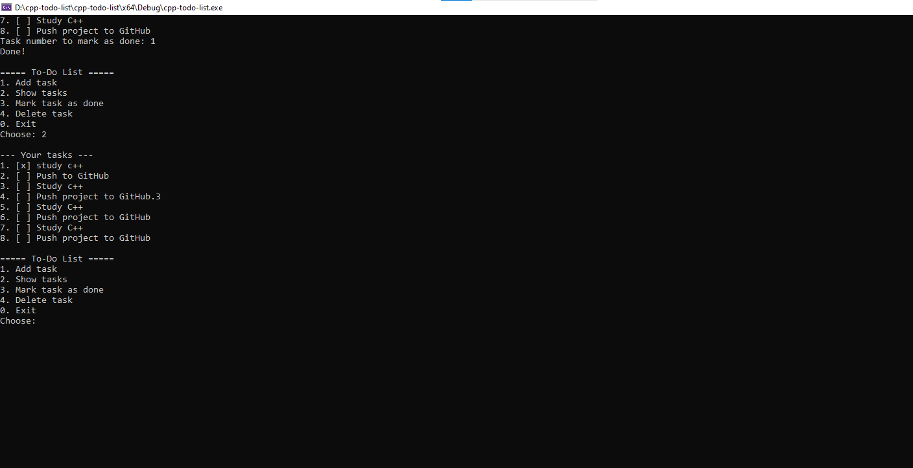

# C++ To-Do List
**Live demo:** https://alaaelbarbary22.github.io/cpp-todo-list/
A simple console to-do list application written in C++ using OOP and file handling.

## Features
- Add new tasks
- View all tasks
- Mark tasks as done
- Delete tasks
- Tasks are saved to a file, so they are kept between sessions
- Input validation for invalid choices and empty titles

## Technologies
- C++17
- Standard Library (`vector`, `string`, `fstream`)
- Visual Studio

## How to run
1. Download or clone this repository
2. Open `cpp-todo-list.cpp` in Visual Studio (or any C++ compiler)
3. Build and run (`Ctrl + F5` in Visual Studio)

Or compile from the terminal:

```bash
g++ -std=c++17 cpp-todo-list.cpp -o todo
./todo
```

## Example

```
===== To-Do List =====
1. Add task
2. Show tasks
3. Mark task as done
4. Delete task
0. Exit
Choose: 2

--- Your tasks ---
1. [x] Study C++
2. [ ] Push to GitHub
```

## What I learned
- Classes and encapsulation (OOP)
- File input/output using `fstream`
- Managing data with `vector`
- Handling invalid user input

## Future improvements
- Task priorities and due dates
- Edit existing tasks
- Search tasks
- Graphical interface

## Author
[Alaa Elbarbary] - [https://www.linkedin.com/in/alaa-elbarbary-71b11742a]
